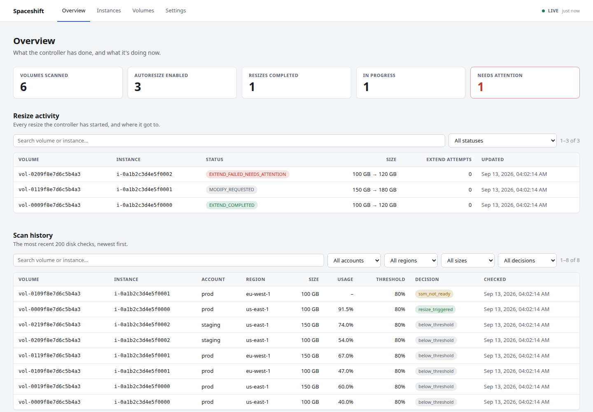
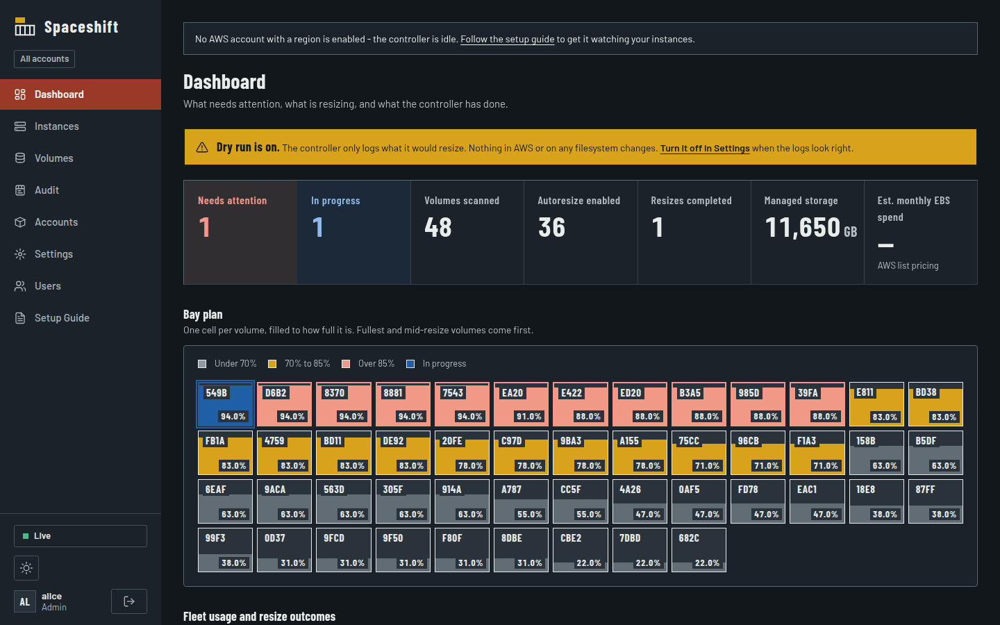

# Spaceshift

Self-hosted controller that watches EC2/EBS disk usage across a fleet and automatically grows a volume — both the AWS-side size **and** the OS-side partition/filesystem — before it fills up.

## Why

Resizing an EBS volume is a two-step process (grow the volume via the EC2 API, then extend the partition/filesystem on the instance), and there's no built-in AWS service that does both steps for you automatically based on real OS-level disk usage. This tool closes that gap: flip a volume or instance to eligible, and it gets monitored and resized on its own.

## How it works

1. **Discovery** — every instance and volume the controller can see gets synced into Postgres each cycle; a volume is only actually watched once its (or its instance's) `autoresize` column is set, with an optional per-resource `threshold_percent` override.
2. **Disk check** — connects to the instance via SSM Send-Command and checks real filesystem usage. There's no AWS API for this — CloudWatch doesn't report it natively either.
3. **Resize** — if usage crosses the threshold, calls `modify-volume`, waits for AWS to complete it, then runs `growpart` + `resize2fs`/`xfs_growfs` remotely to actually extend the filesystem.
4. **State tracking** — every resize attempt is tracked through a state machine in Postgres (its own container, started alongside the controller) so partial failures retry safely, duplicate triggers are prevented, and AWS's limits (4 modifications per 24h, and a 6-hour cooldown between modifications of the same volume) are respected.

v1 supports **Amazon Linux + Ubuntu, ext4 + XFS**. LVM-based volumes are out of scope for now.

## Quickstart

```bash
git clone https://github.com/om-goplani475/Spaceshift.git
cd Spaceshift
cp config.yaml.example config.yaml
cp .env.example .env   # set a real POSTGRES_PASSWORD in it - no default is shipped
docker compose up
```

This starts three containers: the controller, its status dashboard (below), and a Postgres container both use to track resize state (no separate database setup needed — they connect to it automatically using the password from `.env`). `docker compose up` refuses to start if `.env`/`POSTGRES_PASSWORD` is missing, rather than silently running with a guessable password.

`dry_run` defaults to `true` — the controller will log what it *would* resize without ever calling `modify-volume` or running a mutating remote command. Confirm the logs show what you expect against your own AWS account before flipping it off (it's a live-editable setting in Postgres, not a `config.yaml` field — see [docs/SETUP.md](docs/SETUP.md) section 5).

Mark a volume (or the instance it's attached to) as eligible - the first cycle syncs everything it can see into Postgres, but nothing is watched until this is set. The dashboard (below) is the easiest way to do this - flip the `Autoresize` toggle next to the volume/instance on the **Instances** or **Volumes** page. Without the dashboard, it's a direct `UPDATE`:

```bash
docker compose exec postgres psql -U ebs_auto_resize -d ebs_auto_resize \
  -c "UPDATE volumes SET autoresize = true WHERE volume_id = 'vol-xxxxxxxx';"
```

### Status dashboard

Already running as part of `docker compose up` above — no separate command needed. Served at `http://localhost:8089`:

- **Overview** — the numbers that matter (volumes scanned, watched, resizes completed, in progress, needs attention), every resize the controller has started and where it got to, and the most recent disk checks.
- **Instances** and **Volumes** — everything discovered, with an `Autoresize` toggle per row (this is how you mark things eligible). The Volumes page shows what's *actually* in effect after a volume's own flag, its instance's flag, and the default threshold are resolved.
- **Settings** — `dry_run` and every other live-editable setting (see [docs/SETUP.md](docs/SETUP.md) section 5), grouped and described inline, no SQL and no restart.

Managing more than one AWS account (see [docs/SETUP.md](docs/SETUP.md) section 1.4)? Every table is filterable by account alongside region. Pages keep themselves up to date (a 10s poll while the tab is visible, paused when it isn't) — the indicator in the top-right says when the last refresh happened. JSON is also available at `/api/status`, `/api/scans`, `/api/instances`, `/api/volumes`, `/api/config`. No authentication — only run this where you trust who's on the network.

<p>
  
  
</p>

## Setup and configuration

Before running this against a real AWS account, see **[docs/SETUP.md](docs/SETUP.md)** for the full prerequisites (IAM role, SSM-managed instances, marking resources eligible, IMDSv2 gotcha) and a field-by-field reference for every option in [config.yaml.example](config.yaml.example), plus the settings that live in Postgres instead and can be changed without a restart.

## Required AWS permissions

Attach an IAM role to whatever host runs the container — **never put access keys in `config.yaml` or commit them to version control.** A ready-to-copy least-privilege policy is in [docs/iam-policy.json](docs/iam-policy.json); see [docs/SETUP.md](docs/SETUP.md) for what each statement is for.

Not running on EC2 (no instance role available)? Set `credentials.mode: static` and an access key in `config.yaml` instead — see [docs/SETUP.md](docs/SETUP.md). The role-based path above remains the recommended default.

## Connection method

The controller talks to instances exclusively via **SSM Send-Command** — no inbound port, no key management, auth is purely the IAM role above. Target instances need the SSM Agent running and `AmazonSSMManagedInstanceCore` on their own instance profile; see [docs/SETUP.md](docs/SETUP.md).

## Running in Docker

- The container runs as a non-root user by default.
- **Health and recovery.** The controller writes a heartbeat only after a *successful* cycle, with a deadline it computes from your `scheduler.interval_seconds` (plus 30 minutes' grace for a slow cycle). If that deadline passes, `docker ps` shows the container unhealthy - so a loop that's alive but failing every cycle can't look fine. If three consecutive cycles fail (e.g. Postgres unreachable), the controller logs a `CRITICAL` line and exits; `restart: unless-stopped` brings it back with a fresh process and fresh database connections. Seeing that restart in the logs is intentional, not a crash. The `dashboard` service builds from the same image but has no scheduler loop, so it overrides the healthcheck in `docker-compose.yml` with a plain HTTP check against its own page.
- Postgres runs as its own container (`docker-compose.yml`'s `postgres` service), with its data on a named volume (`postgres-data`). That volume holds your eligibility flags, settings, and in-flight resize state — not just history — so back it up; `docker compose down -v` wipes it. Commands and the upgrade procedure are in [docs/SETUP.md](docs/SETUP.md) section 6.
- **IMDSv2 gotcha:** if credentials mysteriously fail *only* inside the container (but work fine directly on the host), it's usually because Docker's networking adds an extra hop to the instance metadata service, and the default IMDSv2 hop limit is 1. Raise the instance's metadata hop limit to 2 to fix it.

## Testing

```bash
pytest
```

See [CONTRIBUTING.md](CONTRIBUTING.md) for full dev setup, including how to run the Postgres-backend tests (which need a real Postgres, not something `moto` can mock).

## Contributing / Security

- [CONTRIBUTING.md](CONTRIBUTING.md) — dev environment, running tests, code style.
- [CODE_OF_CONDUCT.md](CODE_OF_CONDUCT.md) — expectations for everyone participating in the project.
- [SECURITY.md](SECURITY.md) — this tool holds real AWS and instance access; please report vulnerabilities privately rather than via a public issue.
- [CHANGELOG.md](CHANGELOG.md) — what changed between versions.
- [LICENSE](LICENSE) — MIT.
